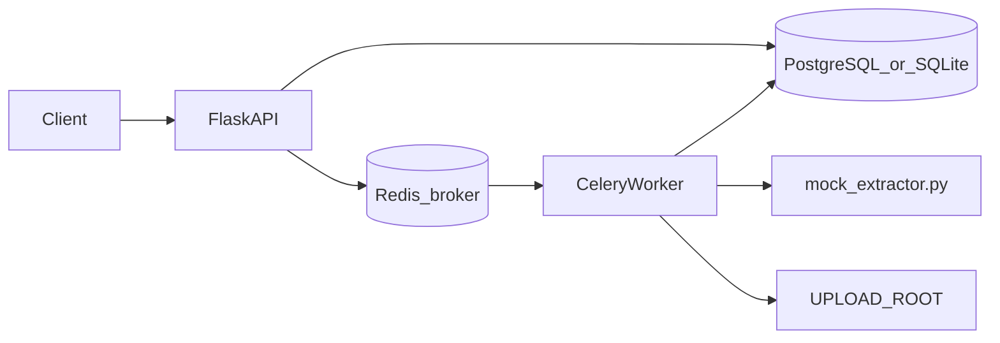

# Design Document — Contract Batch Processor

## Architecture



1. **Upload (sync)** — `POST /api/batches` validates the ZIP (`zip_ingest.py`), persists `Batch` and `Document` rows, extracts files to disk, enqueues one Celery task per document.
2. **Extract (async)** — `extraction.process_document` calls `mock_extractor.extract`, writes `Finding` rows, updates document status, then `recompute_batch_status` in `batch_status.py`.
3. **Review (sync)** — `PATCH /api/findings/{id}` sets `accepted` or `rejected`.
4. **Track (sync)** — Batch and document GET endpoints expose status counts.

Celery uses `task_acks_late=True` and `worker_prefetch_multiplier=1`.

## Data model

| Entity | Purpose |
|--------|---------|
| `Batch` | Upload job, variable list, aggregate status |
| `Document` | One file, disk path, per-file status, idempotency key |
| `Finding` | Extracted value per variable; review status |

Unique constraints: `(batch_id, filename)`, `(document_id, variable_name)`, `idempotency_key`.

## Mock extraction seam

`mock_extractor.py` is the provider boundary:

```python
def extract(file_path: Path, variables: list[str]) -> dict[str, str]: ...
```

## Assumptions, limitations, future scope

See prior design sections in submission brief: local disk, no auth, SQLite default, API-only, no audit trail in v1. Future: real OCR providers, S3 storage, audit events, RBAC, horizontal workers, pluggable parsers.

## Processing limits

- Up to **1,000** documents per ZIP.
- Up to **15 MB** per document (uncompressed ZIP metadata).
- **Async** processing; HTTP returns after enqueue.
