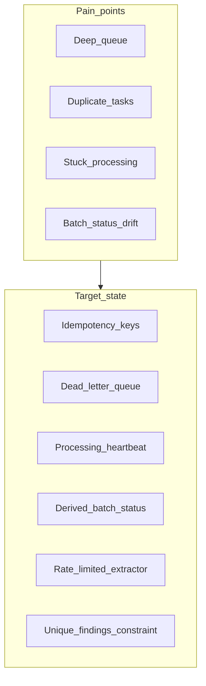

# Production Issue Case Study — Contract Processing

Operations reported slow large batches, stuck documents, extractor timeouts, duplicate processing, high DB load, batch/document status mismatch, and inconsistent findings. Below: causes, investigation, mitigation, permanent fix, risks, and assumptions.

## Cross-cutting themes

- Missing or incomplete **idempotency** → duplicate tasks and findings.
- **Batch status** updated ad hoc or cached without atomic recompute → drift from document states.
- **Worker crashes** with early acks or without lease → lost tasks or infinite `processing`.
- **Unbounded concurrency** → extractor overload, timeouts, connection pool exhaustion.
- **Large transactions** (many inserts per batch) → DB pressure.

---

### 1. Large batches take much longer to complete

**Possible causes:** Fixed small worker pool; high mock/real extractor latency; serial bottleneck on DB writes; no prioritization; large ZIP ingest on API nodes blocking enqueue.

**Investigation:** Celery queue depth vs worker count; task runtime p50/p95 by batch size; DB slow query log on bulk inserts; API CPU during upload; end-to-end batch duration vs document count.

**Immediate mitigation:** Scale workers horizontally; temporarily throttle new batch submissions; increase extractor client pool with cap; split ingest from processing (upload to object store, enqueue metadata only).

**Permanent remediation:** Auto-scale workers on queue depth; shard queues by tenant; pipeline ingest → enqueue in pages; SLA dashboards per batch size.

**Risks:** More workers without rate limits worsen extractor timeouts (issue 3).

**Assumptions:** Extractor is the dominant latency; network to storage is not the bottleneck.

---

### 2. Documents remain in `processing` indefinitely

**Possible causes:** Worker OOM/kill after setting `processing` but before completion; Celery ack/retry misconfiguration; poison message loop; DB commit failure after status update; no stale-job sweeper.

**Investigation:** Documents with `processing` and `started_at` older than SLA; correlate with worker restarts; Celery unacked messages; task failure logs without final document update.

**Immediate mitigation:** Manual requeue or mark failed for jobs older than threshold; restart workers with `prefetch_multiplier=1`.

**Permanent remediation:** Processing **lease/heartbeat** (extend lease while working); stale-job cron resets or requeues; `task_acks_late` + idempotent handlers; visibility timeout aligned with max task duration.

**Risks:** Aggressive sweeper may double-process if idempotency is weak.

**Assumptions:** Max extraction time is bounded and known.

---

### 3. Extraction service increased timeouts

**Possible causes:** Too many concurrent calls; extractor dependency degradation; retries amplifying load; insufficient client timeout vs server time; noisy neighbor batches.

**Investigation:** Outbound QPS vs extractor 5xx/timeout rate; retry counts; compare p99 latency to configured timeouts; circuit breaker state.

**Immediate mitigation:** Circuit breaker (fail fast); reduce worker concurrency; exponential backoff on retries; pause largest batches.

**Permanent remediation:** Token-bucket rate limit per worker; dedicated extraction gateway with bulkhead isolation; adaptive concurrency; bulk API if provider supports it.

**Risks:** Lower concurrency increases batch duration (issue 1).

**Assumptions:** Timeouts are client-side or gateway timeouts, not unbounded server hangs.

---

### 4. Documents processed more than once

**Possible causes:** At-least-once queue delivery; retry after partial success; duplicate enqueue on API retry; missing idempotency key; worker crash after insert but before ack.

**Investigation:** Count tasks per `document_id` in Celery logs; duplicate `findings` groups; compare `idempotency_key` / task_id stored on document; API access logs for double POST.

**Immediate mitigation:** Stop retries without idempotency; dedupe queue by document id; read-only mode on review until stable.

**Permanent remediation:** Idempotent `process_document` (skip if `completed` or findings exist); store Celery task id; unique DB constraint on findings; outbox pattern for enqueue exactly once.

**Risks:** Stricter idempotency may hide legitimate reprocess requests unless a “force reprocess” admin path exists.

**Assumptions:** Duplicate deliveries are the main driver, not intentional re-runs.

---

### 5. Database load increased

**Possible causes:** N+1 queries on batch/document listings; missing indexes on `(batch_id, status)`; large transactions inserting all findings; frequent batch status updates; connection pool too large × workers.

**Investigation:** pg_stat_statements top queries; index usage; connection count vs `max_connections`; lock waits during batch peaks.

**Immediate mitigation:** Add critical indexes; reduce polling frequency; read replica for reporting endpoints.

**Permanent remediation:** Batch inserts for findings; materialized batch summary updated by worker; connection pool sizing = workers + API headroom; cache batch counts with TTL invalidation on document change.

**Risks:** Cached counts reintroduce drift unless invalidated carefully (issue 6).

**Assumptions:** OLTP DB serves both writes and heavy read dashboards.

---

### 6. Batch status does not match document statuses

**Possible causes:** Batch status updated only on create/complete; race when last documents finish concurrently; manual DB edits; cached aggregate not refreshed; failed documents not counted in rules.

**Investigation:** SQL compare batch.status vs derived rule from documents; audit timestamps on batch row vs max(document.finished_at); concurrent finish tests.

**Immediate mitigation:** On-demand recompute endpoint for ops; batch fix script calling shared `recompute_batch_status`.

**Permanent remediation:** Single derivation function (as in this codebase) invoked after every document transition; optional DB trigger or periodic reconciler; expose derived status in API as source of truth.

**Risks:** Full recompute on every doc is O(n) per batch — acceptable at 1k docs, may need aggregation table at scale.

**Assumptions:** Status rules are deterministic and documented.

---

### 7. Missing, duplicate, or inconsistent findings for reviewers

**Possible causes:** Partial task success (some variables inserted before crash); duplicate processing (issue 4); review reads during uncommitted transaction; API returns stale page without transaction isolation; variable list changed mid-batch.

**Investigation:** Find documents with finding count ≠ len(batch.variables); duplicate `(document_id, variable_name)`; isolation level on review reads; version column on findings.

**Immediate mitigation:** Hide documents not in `completed` from review UI/API; dedupe findings script; freeze batch variables after create.

**Permanent remediation:** Unique constraint on findings; transactional insert of all variables; immutable batch.variables snapshot; API filters `review_status` consistently; optional finding `version` for optimistic concurrency.

**Risks:** Hiding in-flight docs may confuse users expecting instant results.

**Assumptions:** One canonical variable list per batch for all documents.

---

## Cause and remediation summary

| Issue | Likely root causes | Immediate mitigation | Permanent remediation |
|-------|-------------------|----------------------|------------------------|
| Slow large batches | Low worker count, extractor latency | Scale workers, throttle uploads | Autoscale, queue sharding, async ingest |
| Stuck `processing` | Worker crash, no lease | Requeue stale jobs | Heartbeat + sweeper + late acks + idempotency |
| Extractor timeouts | Over-concurrency, retry storm | Circuit breaker, lower concurrency | Rate limits, bulkhead, adaptive pools |
| Duplicate processing | At-least-once delivery | Pause retries | Idempotent tasks, unique findings, outbox |
| DB load | N+1, missing indexes, big TX | Indexes, read replica | Batch inserts, summary table, pool tuning |
| Batch status drift | Cached/manual status | Recompute script | Single derive function + reconciler |
| Bad findings | Partial writes, duplicates | Hide non-completed docs | All-or-nothing TX, unique constraints |

## Assumptions (global)

- Celery + Redis (or equivalent) backs task delivery.
- Extractor SLA and max document size are enforced at ingest.
- Reviewers use API/UI that polls batch/document endpoints.
- Production runs multiple stateless API instances and horizontally scaled workers.
